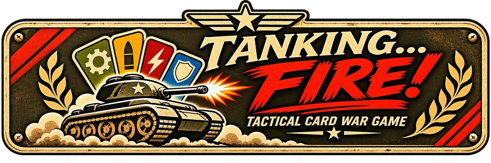

# TANKING... FIRE!



*Tactical Card War Game.* En el póker, *tanking* es pensarse mucho la mano antes de jugar; aquí, después de pensar, se dispara. Antes se llamaba «Línea de Fuego».

Juega en [v0raonline.github.io/tanking-fire](https://v0raonline.github.io/tanking-fire/).

Juego de cartas de tanques de la Segunda Guerra Mundial. Maqueta jugable en una sola página HTML, sin dependencias ni compilación.

Combinas cartas como en el póker, tiras dados y empujas el frente de Normandía hasta la Cota 112. Cada derrota avería una pieza de tu vehículo (oruga, cañón, motor u óptica); los ingenieros y las órdenes de apoyo te mantienen en pie.

## Cómo abrirlo

En Windows, doble clic en `jugar.bat`: arranca un servidor local en el puerto 8790 y abre el juego en `http://localhost:8790`. Hace falta Python. Cierra la ventana negra para pararlo.

En cualquier sistema, desde la carpeta del repositorio:

```
python -m http.server 8790
```

y entra en `http://localhost:8790`. Abrir `index.html` con doble clic no funciona bien: Chrome y Edge bloquean las máscaras CSS de los esquemas al abrir archivos con `file://`.

Para actualizar a la última versión: `git pull`.

## Qué hay

- 12 vehículos jugables: M4A3E2 Jumbo, IS-2, Tiger I, Jagdtiger, Panther, Panzer IV H, Churchill VII, T-34/85, Cromwell, Sherman Firefly, Tiger II y M26 Pershing.
- Combinaciones de póker con dados. La **potencia de fuego** de cada ronda = base de la combinación + valor de sus cartas (2–5: 0, 6–10: +1, J–A: +2) + dados + 1 por cada carta del palo afín en la combinación. Solo cuentan las cartas que forman la combinación; las sueltas vuelven a la mano.
- Quien gana avanza el frente y quien pierde se repliega. Con la oruga rota el ganador no persigue (la siguiente ronda se combate 400 m más lejos) y el perdedor no puede replegarse (impacto a quemarropa, blindaje −1, y la siguiente ronda a la distancia mínima). Un aviso en la bandeja explica cada caso.
- Manual de campaña en papel envejecido, con capturas, accesible desde el menú, desde Intendencia y desde el panel. Sus tablas se generan con los datos del propio juego.
- Parte de guerra como teletipo plegable bajo el marcador.
- Averías por pieza, cartas de apoyo (tarjetas de órdenes perforadas) e Ingeniero para reparar.
- Cuatro batallas con informe histórico, frente propio de 7 sectores con su terreno y distancias, y una regla especial: Villers-Bocage (emboscada), Cota 112 (altura dominante), Remagen (río a la espalda) y Berlín (barricadas). Remagen y Berlín se desbloquean ganando la batalla anterior en campaña; en partida libre están todas abiertas.
- Modo Ofensiva: rivales encadenados hasta caer, del bando contrario por orden de entrada en servicio y un nivel más difícil cada vez (del sexto en adelante, Capitán con órdenes extra). Las averías se arrastran; tras cada victoria el mecánico tira 1d6 por pieza averiada (5–6 la repara) y en intendencia se pagan reparaciones, órdenes y faldones con los puntos acumulados. Multiplicador de racha: ×(1 + 0,1 por rival anterior).
- Disparo animado con balística sencilla: velocidad en boca real del proyectil perforante de cada cañón, frenado aerodinámico y caída por gravedad (curva exagerada ×20 en vertical), con un cuadro semitransparente de datos de vuelo.
- Zoom de impacto con las vistas frontal y superior del blanco.
- Ficha técnica de cada vehículo: medidas reales, datos históricos y comparación a escala.
- Nivel 0: ronda guiada para aprender a jugar.
- Niveles 1–5 (Recluta, Cabo, Sargento, Teniente, Capitán) en modo campaña, que desbloquea el siguiente al ganar, o en partida libre. Al subir de nivel desaparecen las ayudas para elegir combinación, la máquina juega mejor, las órdenes de apoyo pasan a depender de una tirada con éxito parcial y, en el nivel 5, la distancia de combate modifica el blindaje.
- Efectos de sonido grabados: cañonazo, impacto que penetra, rebote, explosión de fuera de combate y fanfarrias de victoria y derrota; los dados se sintetizan en el navegador (Web Audio). Clic suave al seleccionar o deseleccionar cartas y órdenes (más agudo al seleccionar), con interruptor propio. Al terminar la batalla la música se apaga, suena la fanfarria y después entra la del menú. Si una grabación no carga, suena la versión sintetizada. La música baja durante el disparo.
- Tablero en dos pasos: tocas cartas de la mano para **cargarlas en tu formación**, junto a tu tanque (tocándolas allí vuelven a la mano), cargas si quieres una orden de combate en su hueco y disparas con el botón **¡Fuego!** del tanque, que muestra la potencia esperada. Bajo la formación se ve la cuenta. Las combinaciones posibles van en una tira bajo la mano y cargan una jugada de un toque. «Cambiar cartas» activa un modo cambio (marcas hasta 3 y confirmas).
- Disposición en dos filas alineadas: tablero y panel (Intendencia, marcador, parte de guerra) arriba; mano y órdenes de apoyo abajo. Intendencia incluye:
- Banda sonora con dos pistas (menú y batalla), fundido al cambiar y bucle sin corte. Interruptores separados para la música del menú y la de batalla, en Intendencia y en la pantalla de elegir vehículo, con volumen común.
- Barra de zoom propia en el lateral izquierdo (70–150 %), porque dentro del marco del artefacto el zoom del navegador no siempre funciona. En móvil se oculta.
- Estadísticas locales: mejor puntuación por batalla (top 10), mejor mano, rondas ganadas y perdidas, avances y retrocesos del frente, impactos recibidos y causados (y cuántos penetraron), victorias por vehículo y órdenes usadas.
- Distancia de combate según el terreno del sector disputado, con telémetro en el tablero.

## Estructura

```
index.html   el juego completo (HTML, CSS y JS en un solo archivo)
jugar.bat    lanzador para Windows (servidor local en el puerto 8790)
audio/       banda sonora: menu.mp3 y batalla.mp3 (128 kbps, sin silencio final)
audio/sfx/   efectos grabados: canon.mp3, canon_pesado.mp3 (122 y 128 mm), penetra.mp3, rebote.mp3, explosion.mp3, victoria.mp3, derrota.mp3, clic.mp3
img/         esquemas de alambre en WebP con fondo transparente
             <vehículo>.webp         vista lateral derecha (tu tanque, mirando a la derecha)
             <vehículo>_left.webp    vista lateral izquierda (el rival, mirando a la izquierda)
             <vehículo>_front.webp   vista frontal (zoom de impacto)
             <vehículo>_top.webp     vista superior (zoom de impacto)
             papel.webp              textura de papel envejecido
             manual/                 capturas del manual (se regeneran desde el juego si cambia la interfaz)
```

**Licencia:** © 2026 V0ra (v0raonline). El código, las reglas, los textos y el arte propio se publican con la licencia [PolyForm Noncommercial 1.0.0](LICENSE): se pueden usar, copiar y modificar sin fines comerciales. Los créditos y las licencias del material de terceros están en [CREDITS.md](CREDITS.md). El estado del trabajo y los siguientes pasos, en [ESTADO.md](ESTADO.md).

## Créditos y fuentes

- Disparo, impactos y calibración de vistas: Armor Sandbox, el proyecto propio de V0ra del que salió este juego (sin publicar). Esquemas de alambre: modelos 3D de terceros con licencia CC BY (autores en CREDITS.md).
- Textura de papel envejecido del informe histórico (`img/papel.webp`): generada a medida con ChatGPT.
- Efectos de sonido (Pixabay, licencia de contenido de Pixabay: uso gratuito, también comercial, sin atribución obligatoria): cañonazos de «Tank shots» por freesound_community (ID 86181); impacto que penetra de «Metal whoosh hit 11» por floraphonic (ID 202177); rebote de «Metal whoosh hit 9» por floraphonic (ID 201909); explosión de fuera de combate de «Explosion effect» por Dragon Studio (ID 494317); victoria de «Victory bell success fanfare» por emand_edroff (ID 576275); derrota de «French horn fanfare 12» por freesound_community (ID 42899), recortada a 6 s; clic al seleccionar de «Menu beep short snap» por liecio (ID 533778). Recortados, con fundido y nivel igualado.
- Música: «Call of Steel» (menú) y «Symphony of Steel» (batalla), generadas con **Google Flow Music** (antes Riffusion); los archivos originales llevaban credenciales de contenido C2PA de Google y el audio incluye la marca de agua SynthID. Google no reclama la propiedad de lo generado, pero no publica una concesión clara de uso comercial para el plan gratuito, y la música generada íntegramente por IA puede no tener protección de derechos de autor. **Antes de cualquier uso comercial, confirmar por escrito los derechos del plan contratado.**
- Datos históricos (peso, cañón, blindaje, tripulación, velocidad) y velocidades en boca: Wikipedia y otras referencias públicas. Las cifras de peso, velocidad y blindaje varían entre fuentes; el juego muestra las más citadas.

## Niveles

| Nivel | Combinaciones | Panel de formación | Órdenes de apoyo | La máquina |
|---|---|---|---|---|
| 1 · Recluta | lista completa | con puntos | completas, empiezas con 3 | se equivoca a menudo |
| 2 · Cabo | solo la mejor | con puntos | completas | juega razonable |
| 3 · Sargento | solo avisos de jugadas a medias | con puntos | completas | juega bien y usa apoyo |
| 4 · Teniente | ninguna | con puntos | con tirada 1d6 | juega bien y usa apoyo |
| 5 · Capitán | ninguna | solo el nombre | con tirada, empiezas con 1 | igual, y la distancia modifica el blindaje |

Tirada de órdenes (niveles 4 y 5): 5–6 efecto completo, 2–4 a medias, 1 falla y la orden vuelve a la mano. El progreso de la campaña y las estadísticas se guardan en el navegador (localStorage).

Puntuación por batalla (los **puntos**, distintos de la potencia de fuego de cada ronda): victoria = 1000 × nivel; +100 por ronda ganada; +150 por sector de ventaja al terminar; +50 por pieza intacta; −50 por ronda jugada. En derrota solo cuentan rondas ganadas y sectores de ventaja.
